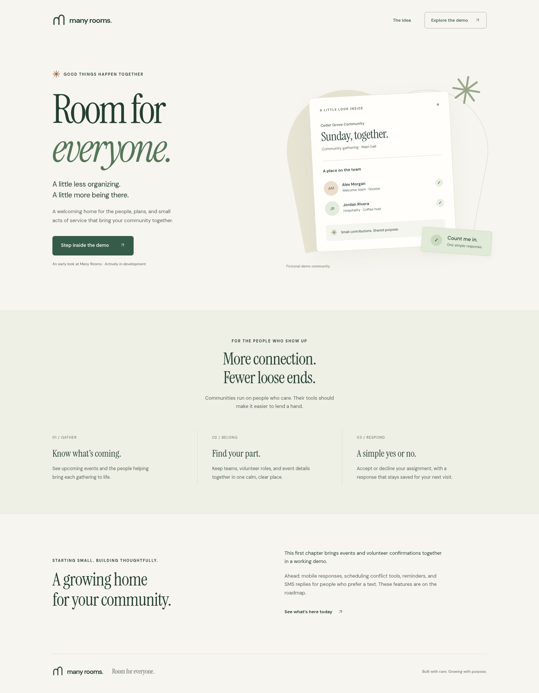
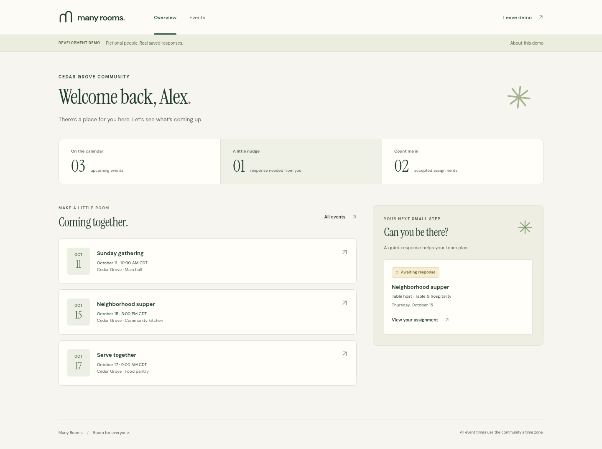
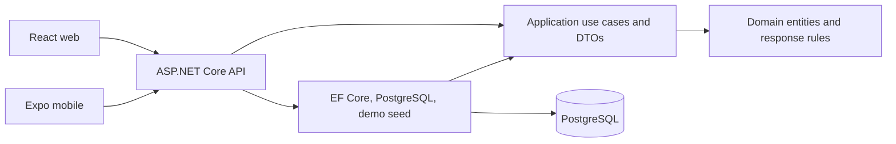

# Many Rooms

**Room for everyone.**

Many Rooms is a web and mobile platform in active development for churches and community organizations. It starts with a small, practical question: **who is serving, and have they confirmed?**

I’m building it to make volunteer coordination easier for the people organizing gatherings and the people giving their time. The goal is useful software shaped by real community needs, with space to grow into communication, reminders, and SMS responses.

## Current milestone

The first milestone connects a public landing page and volunteer dashboard to an ASP.NET Core API and PostgreSQL. In the development demo, a volunteer can open an event, see team assignments, accept or decline their own assignment, and refresh to retrieve the saved response. The API enforces membership and assignment ownership, checks stale updates, and records response history.

The Expo mobile app establishes the same brand, API configuration, and demo/dashboard foundation. Web and mobile do not yet have feature parity. Production authentication, scheduling conflict detection, SMS delivery, recurring events, and organization administration are roadmap items, not finished features.

**The demo is development-only, fictional, and shared. It is not production authentication.**

## Screenshots

Captured from the working local demo, using fictional seed data:





See the [event response screen](docs/screenshots/many-rooms-event.png) and [mobile-width dashboard](docs/screenshots/many-rooms-dashboard-mobile.png). Browser validation also saves screenshots under `apps/web/test-results/` (ignored by Git), and GitHub Actions uploads them as a run artifact. Native mobile device screenshots will be added after device validation.

## Architecture

One application and one database, with four small .NET projects and two independent clients:



- **Domain:** entities and assignment response rules, independent of HTTP and EF Core.
- **Application:** assignment-response use case, DTOs, and small persistence/SMS interfaces.
- **Infrastructure:** EF mappings, migrations, queries, transactional persistence, and demo data.
- **API:** ASP.NET authentication/authorization boundary, REST endpoints, validation, ProblemDetails, and OpenAPI.

This keeps business rules reusable for future mobile and SMS responses while avoiding microservices, message buses, and generic repository layers. Clients have separate npm lockfiles so Expo’s React Native compatibility requirements do not dictate web dependencies.

```text
apps/web/                         React + TypeScript + Vite
apps/mobile/                      Expo + React Native + TypeScript
src/ManyRooms.Api/                 HTTP endpoints and demo authentication
src/ManyRooms.Application/         Use cases, DTOs, narrow interfaces
src/ManyRooms.Domain/              Entities and business rules
src/ManyRooms.Infrastructure/      EF Core, PostgreSQL, migrations, seed
tests/ManyRooms.Application.Tests/ Business behavior tests
tests/ManyRooms.Api.Tests/         PostgreSQL API/integration tests
scripts/                          Local environment and database helpers
docs/                             Architecture and security notes
ManyRooms.sln                     Visual Studio-compatible solution
compose.yml                       Local PostgreSQL
```

## Tech stack and prerequisites

- **.NET 10 LTS SDK**, pinned by `global.json`; Visual Studio with .NET 10 support or any editor/CLI.
- **Node.js 24 LTS**, npm, and Git.
- **Docker Engine/Desktop with Compose v2**, for supported PostgreSQL 18.
- Backend: ASP.NET Core, EF Core 10, Npgsql, OpenAPI/Swagger UI, xUnit.
- Web: React, TypeScript, Vite, Vitest/Testing Library, Playwright.
- Mobile: Expo SDK 57 with its compatible React/React Native packages.

No paid cloud account, SMS account, API key, or production database is needed for the local web demo. Use each lockfile with `npm ci`; use Expo’s compatibility tooling when upgrading mobile dependencies.

## Run the web demo locally

From the repository root:

```bash
npm ci
npm run setup
npm run db:up
dotnet restore ManyRooms.sln
npm run db:migrate
npm run db:seed
npm run dev:api
```

Keep the API terminal running. In a second terminal:

```bash
cd apps/web
npm ci
npm run dev
```

Open **http://localhost:5173**. Choose the demo entry, read the demo explanation, and continue as the fictional volunteer. Open an upcoming event, choose **Accept** or **Decline** on your assignment, then refresh. The response is stored in PostgreSQL, not browser storage.

The API listens at **http://localhost:5080**. Inspect it at **http://localhost:5080/swagger**; its OpenAPI document is `/openapi/v1.json`. Readiness is `/health/ready` and liveness is `/health`.

`npm run setup` creates an ignored `.env` with a randomly generated local database password and preserves an existing `.env`. The helpers load it and construct `ConnectionStrings__ManyRooms` without printing credentials. PostgreSQL binds to `127.0.0.1:55432`, avoiding common local 5432 conflicts. Override the host port in `.env` if needed. The API does not automatically apply migrations during ordinary startup.

The Vite client defaults to the local API. To change it, set `VITE_API_BASE_URL` in `apps/web/.env.local` using its example and restart Vite. Browser configuration is public: never put secrets in `VITE_*` or `EXPO_PUBLIC_*` variables.

### Database commands

```bash
npm run db:up       # Start PostgreSQL and wait for its health check
npm run db:migrate  # Restore local dotnet-ef and apply committed migrations
npm run db:seed     # Add fictional demo data; preserve existing responses
npm run db:down     # Stop PostgreSQL; retain the volume
```

To recreate **only this local demo database**, the following intentionally deletes its Docker volume and all local responses:

```bash
docker compose down --volumes
npm run db:up
npm run db:migrate
npm run db:seed
```

The seed uses fixed entity IDs and future event dates at the time it is first created. Rerunning it does not reset decisions or move existing events. Recreate the local demo database when seeded events have passed and you want a fresh walkthrough.

For Visual Studio, open `ManyRooms.sln`. Keep the connection string in user secrets or environment variables; do not put it in `appsettings.json`. The root helpers provide the same environment for CLI use. See [development details](docs/development.md) for migration creation and production build commands.

## Mobile

```bash
cd apps/mobile
npm ci
npm run start
```

Use an Expo development client/Expo Go matching the SDK or the supported platform tooling. For a physical device, copy `apps/mobile/.env.example` to `.env.local`, set `EXPO_PUBLIC_API_BASE_URL` to your computer’s reachable LAN address, and restart Expo. `localhost` on a phone means the phone itself.

To permit a trusted device on your development LAN, set `ASPNETCORE_URLS=http://0.0.0.0:5080` and `AllowedHosts=localhost;127.0.0.1;YOUR_COMPUTER_LAN_IP` in the ignored root `.env` and restart the API; your OS firewall must allow the port. Replace `YOUR_COMPUTER_LAN_IP` with the same IP used by the phone. Restore the default loopback binding afterward. This openly labeled demo identity must not be exposed as public production authentication.

```bash
npm run typecheck
npm run lint
npm run test
npm run build
```

The mobile build command exports the Android JavaScript bundle. It is **not** a signed native APK/AAB or an iOS build. Native device validation and distribution signing require the relevant device/toolchain and your own Expo/Apple/Google configuration.

## Demo identity and authorization

`GET /api/demo/context` exposes the fictional demo identity only when the API is in `Development` and `Demo:Enabled` is true. Clients then send `X-ManyRooms-Demo: true`. The server chooses one fixed seeded user; callers cannot select an arbitrary user ID in that header.

Every organization endpoint checks a real database membership. The response use case also checks that the current user owns the assignment. Database composite foreign keys keep organization-scoped records attached to parents in the same organization. This is a foundation for tenant isolation; it does not make the shared demo header a secret or a real login.

Production will replace the demo handler with a validated identity provider through ASP.NET authentication, map its subject to a user, and retain the membership/ownership checks. See [authentication and organization boundaries](docs/authentication.md).

## Tests and validation

From the root, with PostgreSQL running:

```bash
npm run format:check
npm run lint
dotnet format ManyRooms.sln --verify-no-changes
dotnet build ManyRooms.sln --configuration Release
npm run test:backend
npm run format:check --prefix apps/web
npm run lint --prefix apps/web
npm run typecheck --prefix apps/web
npm test --prefix apps/web
npm run build --prefix apps/web
npm run format:check --prefix apps/mobile
npm run lint --prefix apps/mobile
npm run typecheck --prefix apps/mobile
npm test --prefix apps/mobile
npm run build --prefix apps/mobile
docker compose config --quiet
```

`npm run test:backend` uses a dedicated `manyrooms_test` database and passes `TEST_DATABASE_CONNECTION`. API integration tests use real PostgreSQL; application tests cover decisions, ownership, and stale/closed assignments. Do not point integration tests at an application or production database.

For the complete browser flow, keep API and web running:

```bash
cd apps/web
npx playwright install chromium
npm run test:e2e
```

CI runs formatting, builds, backend tests against PostgreSQL, web tests and browser persistence/accessibility checks, and mobile type checking/dependency/export validation. No release or deployment happens automatically. See [verified results and limits](docs/verification.md).

### Known dependency limitation

The current stable Expo SDK has upstream dependency advisories reported by `npm audit`; see [mobile dependency review](docs/dependencies.md). No forced major overrides or incompatible SDK downgrades are applied to hide them. Review patched compatible releases before native distribution. The web runtime dependency audit reports no known vulnerabilities at this milestone.

## SMS foundation

`ISmsProvider` and the development provider establish an extension point only. No paid provider is connected, no real SMS is sent, and the response workflow does not require SMS. Later, a verified incoming `ACCEPT` or `DECLINE` reply can resolve the sender and assignment, then call the same application use case after authentication, replay protection, and organization checks.

## Roadmap

1. Production authentication, invitation-based memberships, and organization roles.
2. Volunteer availability and scheduling conflict visibility.
3. Leader scheduling tools, team management, and recurring events.
4. Mobile event details and assignment responses using the existing API.
5. Reminder/notification delivery and authenticated SMS Accept/Decline replies.
6. Calendar integrations and focused team communication.

The first milestone deliberately does not implement every church-management feature. Keep future work focused on demonstrated needs and preserve a simple, welcoming experience.
