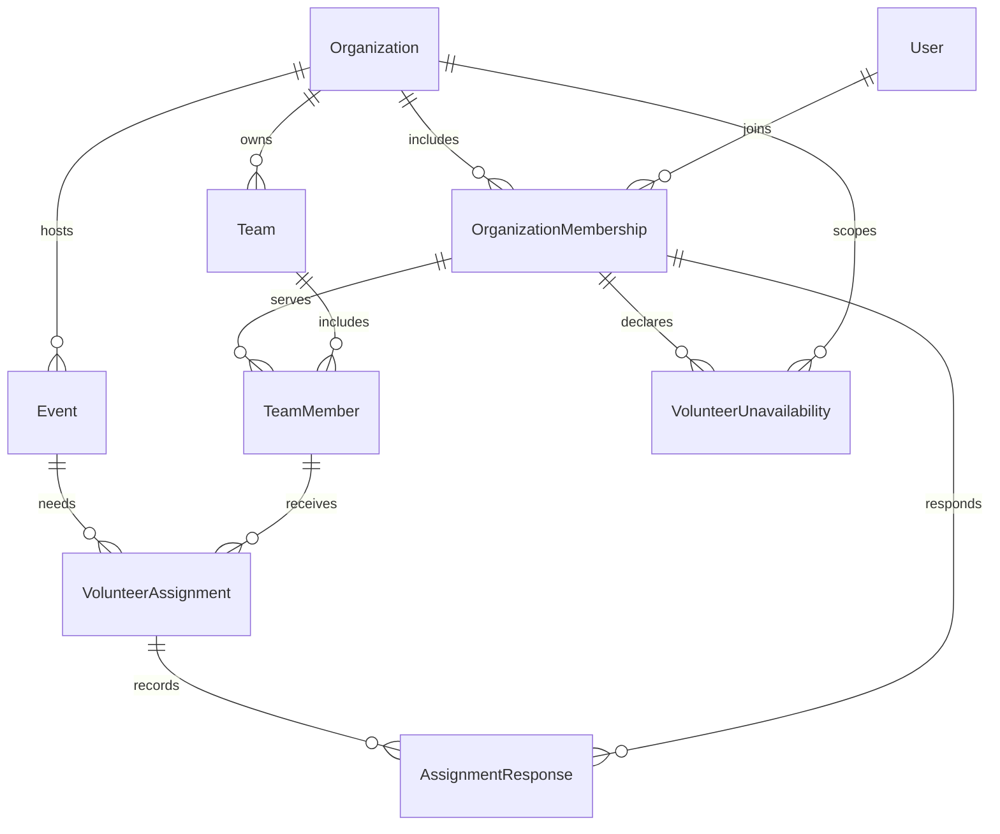

# Development details

## Data model

Users can join multiple organizations through OrganizationMembership. Each organization owns Teams and Events. TeamMember connects a membership to a team in the same organization. VolunteerAssignment connects an event to a team member and a role. AssignmentResponse records each accepted/declined decision and the resulting assignment version.

VolunteerUnavailability belongs to a membership in one organization and stores an explicit unavailable range, an optional private note, timestamps, and a version. Conflict information is derived from assignments/events and these ranges; there is no persisted conflict flag to synchronize.



Entities use GUID primary keys and creation/update timestamps. Scoped entities have `(OrganizationId, Id)` alternate keys for tenant-safe foreign keys. Uniqueness constraints prevent duplicate memberships and team memberships; date/status/version checks reject invalid rows. Status is summarized on the assignment while responses provide its history.

## API

| Method | Path                                                                      | Purpose                                        |
| ------ | ------------------------------------------------------------------------- | ---------------------------------------------- |
| GET    | `/health`                                                                 | Liveness                                       |
| GET    | `/health/ready`                                                           | Database readiness                             |
| GET    | `/api/demo/context`                                                       | Development-only fixed demo context            |
| GET    | `/api/organizations/{organizationId}/dashboard`                           | Current volunteer summary, events, assignments |
| GET    | `/api/organizations/{organizationId}/events`                              | Upcoming events                                |
| GET    | `/api/organizations/{organizationId}/events/{eventId}`                    | Event and team assignments                     |
| PUT    | `/api/organizations/{organizationId}/assignments/{assignmentId}/response` | Save the current volunteer’s decision          |

Request body:

```json
{ "decision": "Accepted", "expectedVersion": 1 }
```

The response is the updated assignment DTO. `Declined` is the other allowed decision. Validation failures return 400, unauthenticated requests 401, denied membership/ownership 403, missing scoped resources 404, and stale/closed assignments 409. Errors use ProblemDetails. On 409 clients reload the current state and ask the user to decide again; they do not silently resubmit.

Swagger UI and `/openapi/v1.json` are available in Development. Add `X-ManyRooms-Demo: true` to protected API requests. No write endpoints for arbitrary organizations, users, events, or teams are exposed in this milestone.

### Milestone 2 endpoints

The following paths are relative to `/api/organizations/{organizationId}`. Every route checks organization membership; leader routes additionally check the stored membership role.

| Method | Path                                           | Purpose                                                                                        |
| ------ | ---------------------------------------------- | ---------------------------------------------------------------------------------------------- |
| GET    | `/availability/{id}`                           | Retrieve one unavailable range owned by the current member; hidden foreign records return 404. |
| GET    | `/availability`                                | List the current volunteer’s unavailable ranges                                                |
| POST   | `/availability`                                | Create an unavailable range                                                                    |
| PUT    | `/availability/{id}`                           | Update an owned range using its expected version                                               |
| DELETE | `/availability/{id}?expectedVersion=N`         | Remove an owned range using its expected version                                               |
| GET    | `/leader/events/{eventId}`                     | Event assignments with all statuses/conflict explanations                                      |
| GET    | `/leader/team-members`                         | Existing members eligible for a new assignment                                                 |
| POST   | `/leader/events/{eventId}/assignments/preview` | Validate an assignment proposal and calculate conflicts without writing                        |
| POST   | `/leader/events/{eventId}/assignments`         | Create a pending assignment and return current conflicts                                       |

Availability creation body:

```json
{
  "startsAt": "2026-10-11T09:00:00-05:00",
  "endsAt": "2026-10-11T11:00:00-05:00",
  "note": "Family commitment"
}
```

Use the same fields plus `expectedVersion` for an update. The API normalizes offsets to UTC. Unknown/foreign-owned availability IDs return 404, invalid input returns 400, and a stale version returns 409. Notes are not included in leader or other-volunteer conflict explanations.

Leader preview/create body:

```json
{
  "teamMemberId": "50000000-0000-0000-0000-000000000001",
  "roleName": "Welcome desk"
}
```

The server checks that the event and team member belong to the organization, that the event has not started, and that the same member/role is not already assigned. Duplicate assignment requests return 409. Conflicts remain advisory. The preview returns `{ "conflicts": [] }` when none are detected; creation returns the new assignment DTO with its conflicts and a 201 status.

Assignment DTOs now include `eventEndsAt` and `conflicts`. Dashboard/event responses and the existing assignment-response PUT use these additions. Regular volunteer event reads only include conflict details for the current volunteer; the leader endpoint includes them for all event assignments. See [scheduling rules](scheduling.md) for interval, status, and privacy semantics.

`GET /api/demo/context?persona=leader` selects the fixed leader context for the development entry screen. Protected leader-demo calls send `X-ManyRooms-Demo: leader`; the ordinary `true` value continues to select Alex. Both are openly shared development personas.

## Migrations

Apply committed migrations with `npm run db:migrate`. To add a schema change after configuring `ConnectionStrings__ManyRooms` in your process or user secrets:

```bash
dotnet tool restore
dotnet ef migrations add DescriptiveChange --project src/ManyRooms.Infrastructure --startup-project src/ManyRooms.Api
dotnet ef database update --project src/ManyRooms.Infrastructure --startup-project src/ManyRooms.Api
```

Review the generated migration, test it against a clean PostgreSQL database, and commit its model snapshot. Ordinary API startup does not silently migrate a database.

For the Milestone 1 → Milestone 2 upgrade, apply the new migration and rerun the additive seed; retain the existing Docker volume. Integration tests verify both the full migration chain from an empty schema and a forward upgrade containing saved Milestone 1 responses. The initial migration is preserved in source control.

## Production artifacts

```bash
dotnet publish src/ManyRooms.Api --configuration Release --output artifacts/api
npm run build --prefix apps/web
npm run build --prefix apps/mobile
```

The API publish directory, Vite `apps/web/dist`, and Expo `apps/mobile/dist` are separate artifacts. Publishing these files does not make the demo a production-ready authenticated service. Production hosting, identity, HTTPS, origin settings, signing, and secret management remain deliberate future setup.

## Troubleshooting

- **Missing SDK:** install the .NET SDK specified by `global.json`, not only the runtime.
- **Database connection refused:** run `npm run db:up` and inspect `docker compose ps`.
- **Password changed but volume retained:** PostgreSQL initializes its password once. Restore the password associated with the volume, or deliberately recreate the local database as described in the README.
- **Demo unavailable:** use Development, enable the demo setting, apply migrations, and run the seed.
- **No upcoming events:** the demo’s original event dates may have passed; recreate the local demo database for new dates.
- **Phone cannot connect:** use the host LAN address in the mobile public API configuration, allow the local API port through the firewall, and bind the development API to that interface.
- **Stale response:** another browser changed the assignment; reload and respond using the current version.
