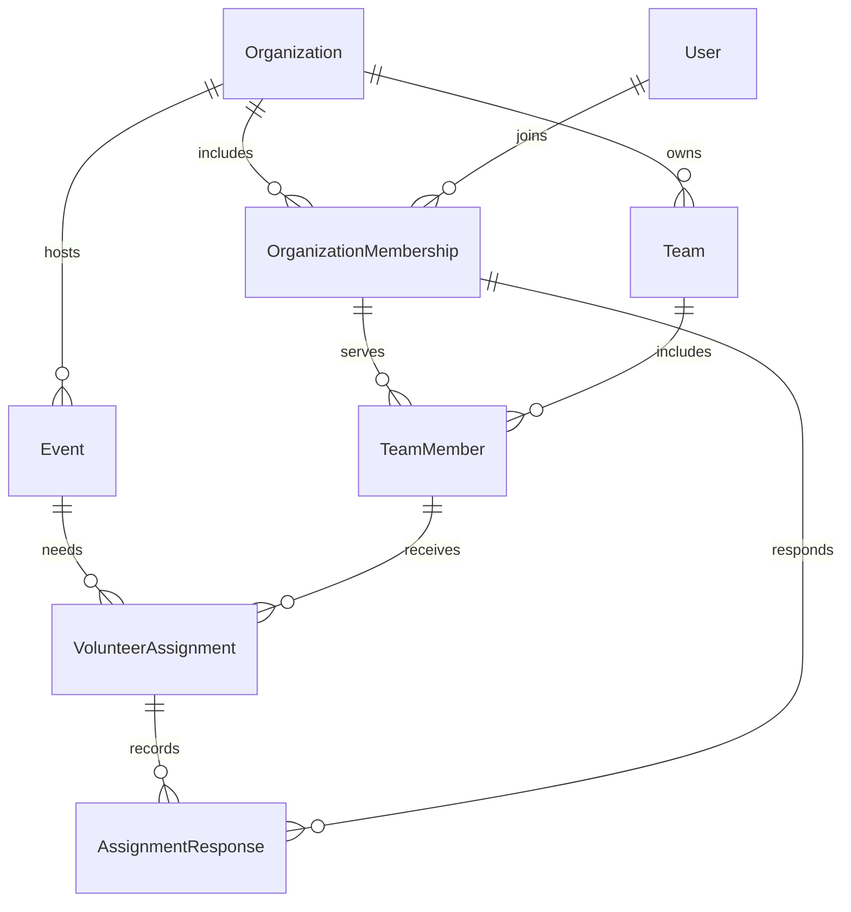

# Development details

## Data model

Users can join multiple organizations through OrganizationMembership. Each organization owns Teams and Events. TeamMember connects a membership to a team in the same organization. VolunteerAssignment connects an event to a team member and a role. AssignmentResponse records each accepted/declined decision and the resulting assignment version.



Entities use GUID primary keys and creation/update timestamps. Scoped entities have `(OrganizationId, Id)` alternate keys for tenant-safe foreign keys. Uniqueness constraints prevent duplicate memberships and team memberships; date/status/version checks reject invalid rows. Status is summarized on the assignment while responses provide its history.

## API

| Method | Path                                                                      | Purpose                                        |
| ------ | ------------------------------------------------------------------------- | ---------------------------------------------- |
| GET    | `/health`                                                                 | Liveness                                       |
| GET    | `/health/ready`                                                           | Database readiness                             |
| GET    | `/api/demo/context`                                                       | Development-only fixed demo context            |
| GET    | `/api/organizations/{organizationId}/dashboard`                           | Current volunteer summary, events, assignments |
| GET    | `/api/organizations/{organizationId}/events`                              | Upcoming events                                |
| GET    | `/api/organizations/{organizationId}/events/{eventId}`                    | Event and team assignments                     |
| PUT    | `/api/organizations/{organizationId}/assignments/{assignmentId}/response` | Save the current volunteer’s decision          |

Request body:

```json
{ "decision": "Accepted", "expectedVersion": 1 }
```

The response is the updated assignment DTO. `Declined` is the other allowed decision. Validation failures return 400, unauthenticated requests 401, denied membership/ownership 403, missing scoped resources 404, and stale/closed assignments 409. Errors use ProblemDetails. On 409 clients reload the current state and ask the user to decide again; they do not silently resubmit.

Swagger UI and `/openapi/v1.json` are available in Development. Add `X-ManyRooms-Demo: true` to protected API requests. No write endpoints for arbitrary organizations, users, events, or teams are exposed in this milestone.

## Migrations

Apply committed migrations with `npm run db:migrate`. To add a schema change after configuring `ConnectionStrings__ManyRooms` in your process or user secrets:

```bash
dotnet tool restore
dotnet ef migrations add DescriptiveChange --project src/ManyRooms.Infrastructure --startup-project src/ManyRooms.Api
dotnet ef database update --project src/ManyRooms.Infrastructure --startup-project src/ManyRooms.Api
```

Review the generated migration, test it against a clean PostgreSQL database, and commit its model snapshot. Ordinary API startup does not silently migrate a database.

## Production artifacts

```bash
dotnet publish src/ManyRooms.Api --configuration Release --output artifacts/api
npm run build --prefix apps/web
npm run build --prefix apps/mobile
```

The API publish directory, Vite `apps/web/dist`, and Expo `apps/mobile/dist` are separate artifacts. Publishing these files does not make the demo a production-ready authenticated service. Production hosting, identity, HTTPS, origin settings, signing, and secret management remain deliberate future setup.

## Troubleshooting

- **Missing SDK:** install the .NET SDK specified by `global.json`, not only the runtime.
- **Database connection refused:** run `npm run db:up` and inspect `docker compose ps`.
- **Password changed but volume retained:** PostgreSQL initializes its password once. Restore the password associated with the volume, or deliberately recreate the local database as described in the README.
- **Demo unavailable:** use Development, enable the demo setting, apply migrations, and run the seed.
- **No upcoming events:** the demo’s original event dates may have passed; recreate the local demo database for new dates.
- **Phone cannot connect:** use the host LAN address in the mobile public API configuration, allow the local API port through the firewall, and bind the development API to that interface.
- **Stale response:** another browser changed the assignment; reload and respond using the current version.
